# Sports Routing — staff training

Printable handouts, with the pictures:

- **[STAFF_QUICK_START.pdf](STAFF_QUICK_START.pdf)** — the short version staff can keep at the bar.
- **[STAFF_FULL_GUIDE.pdf](STAFF_FULL_GUIDE.pdf)** — every button, including named TV sets and replacing a program when every DirecTV box is in use.

This page is the same training in text. The older combined file, STAFF_TRAINING.pdf, does not include Sets or Replace. Use the two PDFs above.

Hold the iPad **sideways**. Open the Home Assistant app, sign in, and tap **Sports Routing** in the sidebar.

**Live commit stays off.** The yellow line under the button says *Live commit is off until the room inventory is set up.* Pressing **Take** only plans the change and shows a summary. The TVs do not change until a manager turns Live commit on. That button cannot be turned on yet.

The lists move when you drag them. On the iPad a scrollbar appears only while your finger is moving, then it disappears. You will not see a permanent gray bar.

The program names in these pictures are from one evening. They change through the day. The buttons do not.

---

## 1. Quick start

The screen is three columns, plus **Take** along the bottom.

| Column | What you use it for |
|---|---|
| Left | A sport (Football, Basketball, and the rest). Swipe down for **Guide**, **Now**, and **Sets**. |
| Middle | The games, or the channel list |
| Right | Where it goes: every TV, a split, or TVs you pick |

**Take** stays gray until you have both a program and a place to put it. When it turns blue, the line above it is the plan in one sentence.

### One game on every TV

1. Tap the sport on the left.
2. Tap a league if you need one (**NFL**, **NCAA Basketball (M)**, and so on). **All** shows every game in that sport.
3. Tap the game. It turns blue.
4. On the right, tap **All 35 TVs**.
5. Tap the blue **Take**.
6. Read the summary, then tap **Dismiss**.

### One game on a few TVs

Basketball, then **NCAA Basketball (M)**, then the game. Tap **Pick TVs** and tap the TV numbers. Tap a number again to remove it. **Clear TVs** removes all of them.

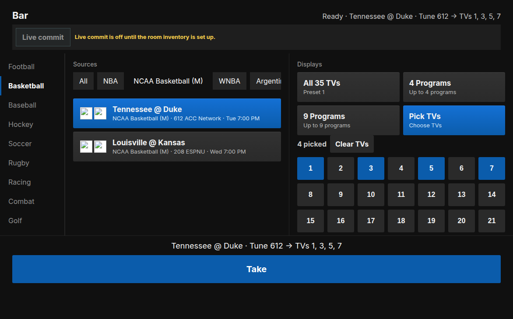

The top right reads **Ready · Tennessee @ Duke · Tune 612 → TVs 1, 3, 5, 7**. **612** is the DirecTV channel. Tap **Take**.

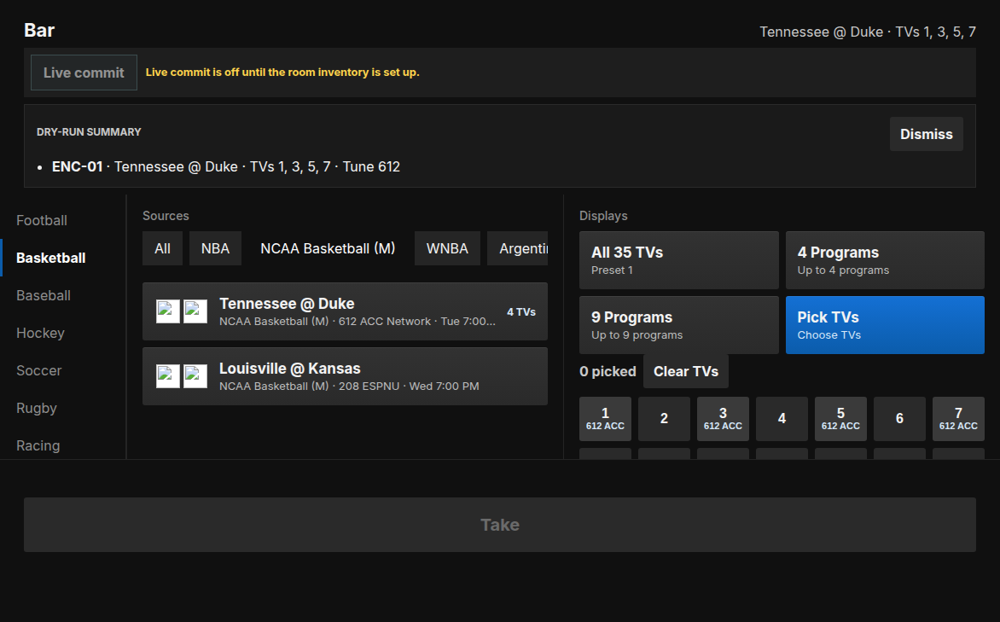

The summary names the DirecTV box, the game, the TVs, and the channel. **Dismiss** closes it. Nothing was sent to the wall. The game card then shows a badge such as **4 TVs**, and those TV buttons show the channel.

### What is on each TV

Swipe the left column to the bottom and tap **Now**.

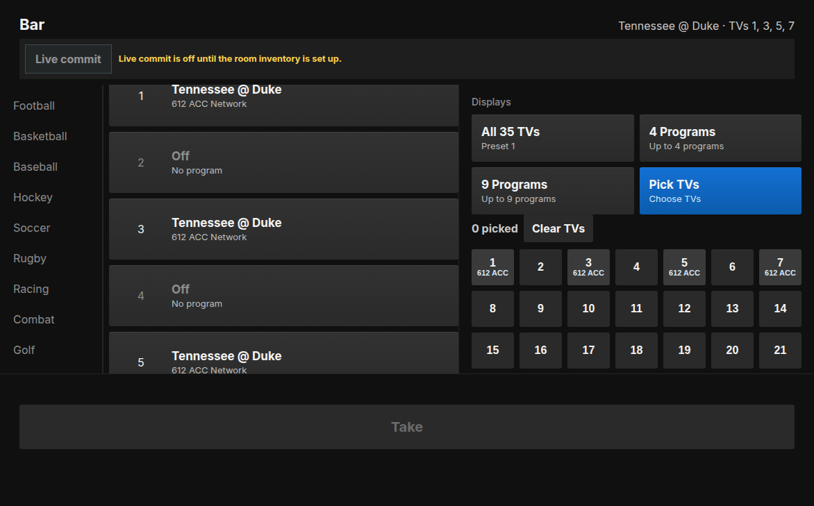

Every TV is listed. After the Take above, 1, 3, 5, and 7 show the game and channel **612**. The others say **Off**.

### Find a channel that is not a game

Swipe the left column and tap **Guide**. The list is DirecTV for Greensboro (ZIP 27403). The box says **Search by channel, name, or title**.

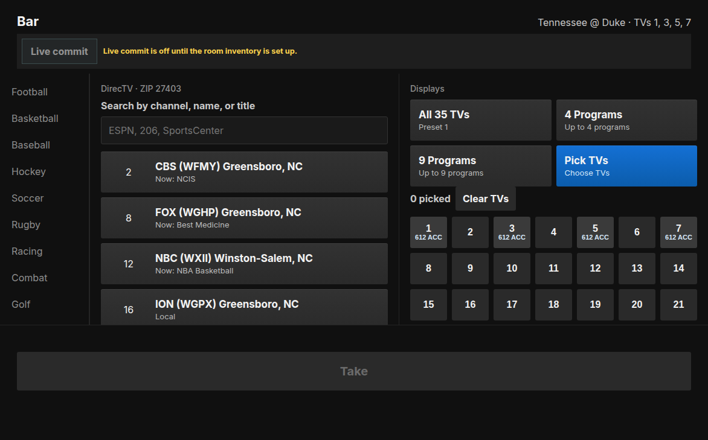

Search works three ways:

- **Channel name.** `HGTV` leaves channel **229**.

  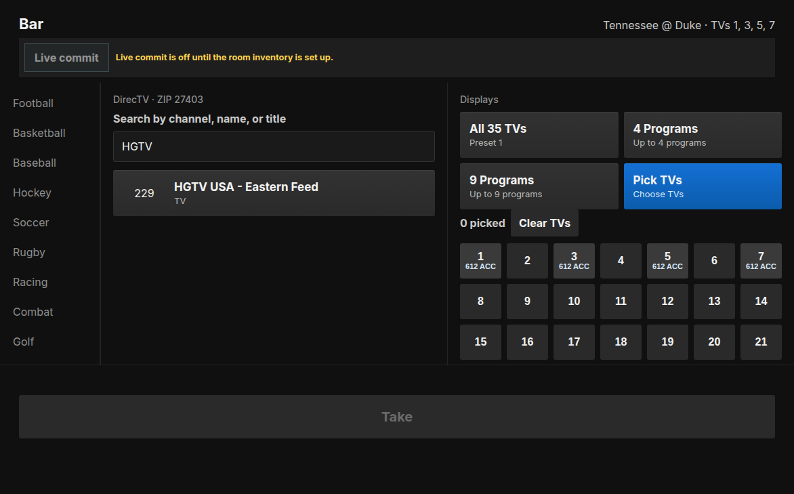

- **What is on right now.** `NCIS` finds CBS **2**, because that is the current program.

  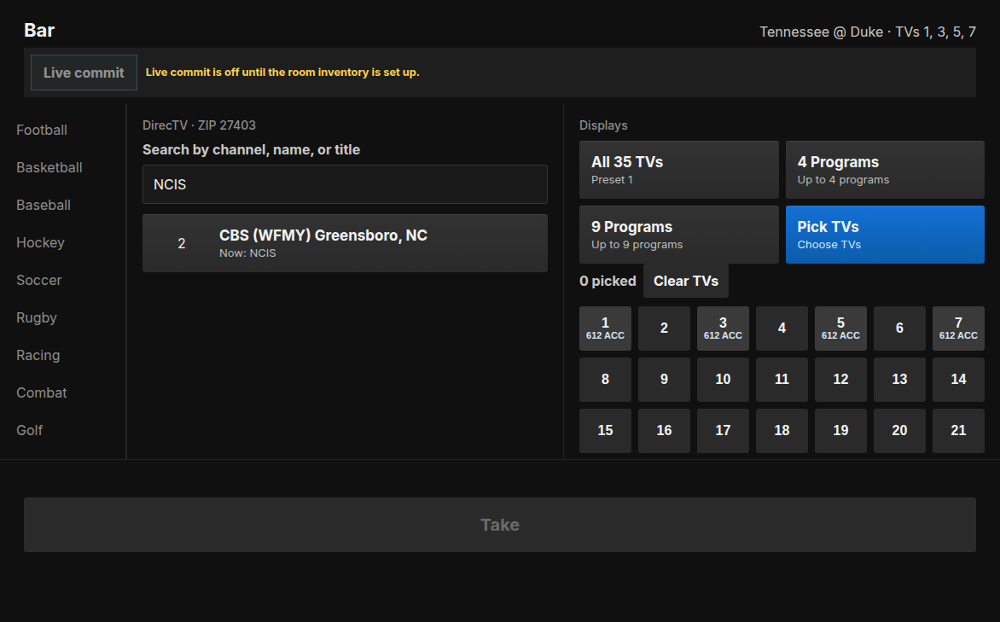

- **Channel number.** `206` finds ESPN.

Tap the row, then **All 35 TVs** or **Pick TVs**, then **Take**.

### Several games at once

Tap **4 Programs** *before* you tap the games. Then tap up to four games. Each one you tap turns blue. You do not pick TV numbers. The first game goes on one set of TVs, the next game on the next set. TVs that do not get a game stay on whatever they were already showing.

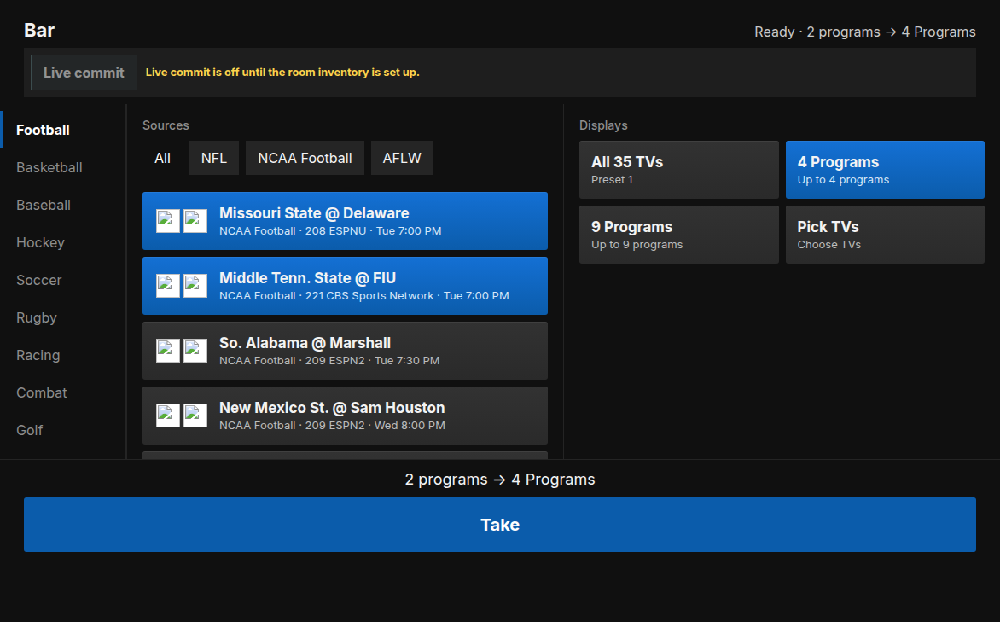

The line above Take reads **2 programs → 4 Programs**. **9 Programs** is the same idea, with up to nine games.

A game that has no channel number can still be in the list. **Take** will not tune it.

### A named set of TVs

Swipe the left column to **Sets**. Type a name such as Patio (24 characters at most), tap the TV numbers, then **Save**. You need at least one TV. Eight sets is the limit. The same name cannot be saved twice. A TV can be in more than one set.

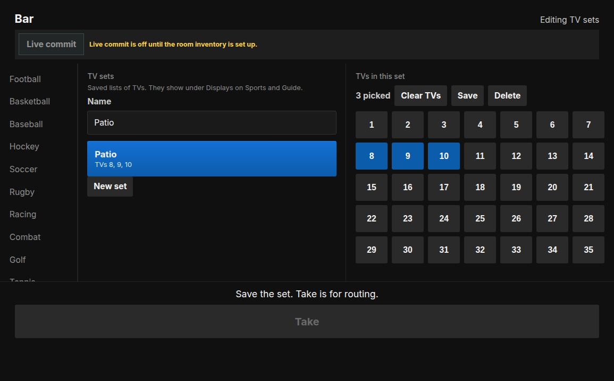

The name shows under Displays on Sports and on Guide, under All 35 TVs, 4 Programs, 9 Programs, and Pick TVs. Tap the game, tap **Patio**, tap **Take**. Only the TVs in the set change. **Delete** removes the button. It does not clear TVs that were already routed.

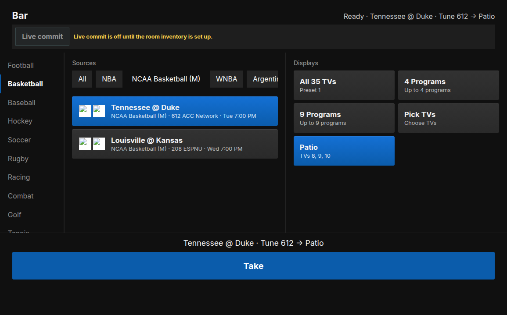

### When every DirecTV box is in use

**All 35 TVs**, **4 Programs**, and **9 Programs** do not get stuck. They reuse their own boxes. **Pick TVs** and a named set need a free box (ENC-01 through ENC-10).

If every TV you picked is already on exactly one box, Take reuses that box. No chooser. TVs that were on that box but are not in the set turn off, because one box is one channel.

If the TVs are not already one box and no box is free, Take stays gray. The header says **All DirecTV boxes are in use**. The middle column becomes **Choose a program** and lists what is on, with the channel and the TVs. Tap the one that should go off. Take becomes **Replace**.

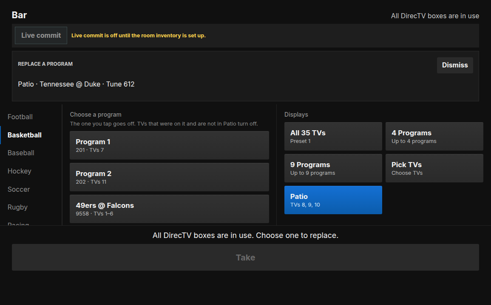

The summary names the box, the new program, the set’s TVs, the channel, and an off line for the program you replaced.

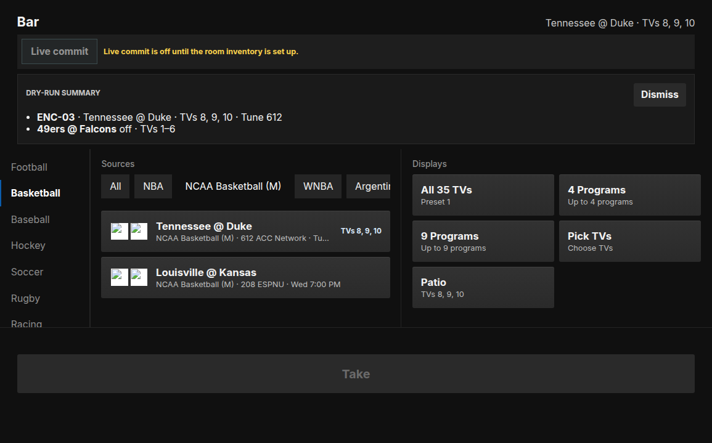

Dismiss on the banner leaves the game and the set selected. Only the box you chose changes. Other programs stay.

---

## 2. Full guide

### How to open it

1. Home Assistant Companion, or Safari, signed in to the bar’s Home Assistant.
2. Sidebar: **Sports Routing**.
3. Turn the iPad sideways. In portrait the columns stack and the buttons get small. Landscape is the layout in these pictures.

Sports Routing is the screen staff use during a game. **AVAccess Matrix** (favorites such as FOX Local) is a separate sidebar item and is not covered here.

### How the screen is laid out

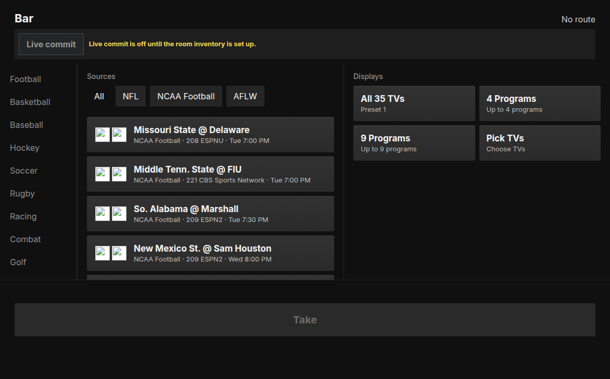

- **Bar** is the room name. The top right is **No route** until a plan is ready, then a one-line description of what Take will do.
- **Live commit** is the switch that would send the plan to the DirecTV boxes and the TVs. It is off, and the yellow line says why. Leave it off.
- **Left rail.** DirecTV’s own sports, in this order: Football, Basketball, Baseball, Hockey, Soccer, Rugby, Racing, Combat, Golf, Tennis, Cricket, Volleyball, Rodeo, Raquet Ball. **Guide**, **Now**, and **Sets** are under that list. Swipe the rail. There is no permanent scrollbar.
- **Sources** (middle). League chips, then the games. On Guide, this column is the channel list and the search box. On Now, it is the TV-by-TV list.
- **Displays** (right). **All 35 TVs**, **4 Programs**, **9 Programs**, **Pick TVs**, or a named set such as **Patio**. Only one of these is active. Choosing a preset clears a set. Choosing a set clears the preset. Pick TVs is the one-off number grid.
- **Take** (bottom). Gray and disabled until a program and a destination are both chosen. Blue means the plan is ready. The sentence above the button is the same plan.

### Sports

The game list comes from DirecTV’s sports page for this bar (Greensboro, ZIP 27403, Bars and Restaurants). It is not filled from the TV guide.

What you will see:

- College football on ESPNU, ESPN2, and the other sports channels.
- NFL, including Sunday Ticket channels. Those numbers are high, such as **9558**.
- College basketball, men’s and women’s, including games on ACC Network (Duke on **612** in the pictures).
- NBA, including out-of-market games on NBA League Pass (a number such as **1204**).
- The other sports on the left rail, when DirecTV has games that day.

Locals stay in the guide and can carry a game: **2** CBS (WFMY), **8** FOX (WGHP), **12** NBC (WXII), **45** ABC (WXLV).

Under **Sources**, **All** shows every game in the sport you tapped. The other chips are the leagues inside that sport (NFL, NCAA Football, NBA, NCAA Basketball (M), and so on). A sport with one league has no extra chips.

Each card shows the two teams, the league, the channel number and name, and the start time. Tap a card to select it. Tap it again to clear it when you are in **4 Programs** or **9 Programs**. For a single game, tap a different card to switch.

If a card has no channel number, it is listed so you can see the game, but Take will not tune it.

The list refreshes when the iPad opens the page, and about every 15 minutes after that.

### Guide

Guide is the DirecTV Greensboro lineup from TV Passport. It is the full lineup staff can actually put on a TV, with these left out:

- Music-only channels (Music Choice, Sirius, and similar). Music *video* networks such as MTV stay.
- Pay-per-view and Hot Choice.
- Promo barkers (Audience Network).
- On-demand menus.
- A second copy of a station that already has its real channel number (the extra copy is usually a 9000-series number).

News, HBO, shopping, and the sports channels stay.

**Now** and **Next** (the program title under the channel name) are filled for the main locals and sports channels: 2, 8, 12, 45, 206 ESPN, 209 ESPN2, 219 FS1, 245 TNT, and 9554. The other channels show the number and name only.

If the program list is missing or more than six hours old, a banner says **Guide listings unavailable — channel list only**. You can still search by number or name and still Take a channel. You just will not see what is on.

Search matches the channel number, the channel name, the category, and the Now or Next title. It waits a moment while you type so the cursor is not stolen. Clear the box to get the full list back.

The titles in the pictures (`NCIS` on CBS 2, `Best Medicine` on FOX 8, `NBA Basketball` on NBC 12) are whatever was on that evening. Tomorrow the same search can find a different channel.

### Where the picture goes

**All 35 TVs** (Preset 1). One game or one channel, on every TV. The summary names **ENC-01**. That is the first DirecTV box. The tune line is `Tune` plus the channel number.

**4 Programs** (Preset 2). Tap this first, then tap up to four games or channels. The order you tap is the order of the boxes: first pick is ENC-01, second is ENC-02, and so on. The room is striped, not blocked into four corners:

| Pick | DirecTV box | TVs |
|---|---|---|
| 1st | ENC-01 | 1, 5, 9, 13, 17, 21, 25, 29, 33 |
| 2nd | ENC-02 | 2, 6, 10, 14, 18, 22, 26, 30, 34 |
| 3rd | ENC-03 | 3, 7, 11, 15, 19, 23, 27, 31, 35 |
| 4th | ENC-04 | 4, 8, 12, 16, 20, 24, 28, 32 |

If you only pick two games, ENC-03 and ENC-04 are left alone, and the TVs in those two rows stay on whatever they were already showing. Extra taps past four are ignored. The line above Take tells you how many you have picked (`2 programs → 4 Programs`).

**9 Programs** (Preset 3). Same rule, up to nine games, nine boxes (ENC-01 through ENC-09). TVs are striped by nine: TV 1 with the first game, TV 2 with the second, TV 10 with the first game again.

**Pick TVs.** Choose the exact screens for this one plan. Tap numbers, tap again to remove, or **Clear TVs**. This uses the lowest free DirecTV box from ENC-01 through ENC-10. ENC-10 is the spare.

**Named sets.** **Sets** at the bottom of the left rail saves a name and a list of TVs (Patio is 8, 9, and 10 in the pictures). Save needs a name and at least one TV. Eight sets is the limit. Duplicate names are refused. The button then appears under Displays on Sports and Guide. Tap one program, tap the set, tap Take. A TV can belong to more than one set; the later Take wins on a shared TV. Delete removes the button only. It does not clear a route that already happened. The iPad keeps the list. When Home Assistant is connected, the same save writes `custom_tv_sets.json` so a replacement iPad can load it.

**No free box.** Pick TVs and a named set are the only paths that need a free box. If every selected TV is already on exactly one box, Take reuses that box and the summary names any leftover TVs that turn off. If the selection spans more than one box and none are free, the middle column lists the programs already on. Tap one. Take becomes **Replace**. The summary is one line for the new plan and one off line for the program you replaced, for example `49ers @ Falcons off · TVs 1–6`. Other programs stay. All 35, 4 Programs, and 9 Programs overwrite their own boxes and never open this chooser.

You plan either a preset or a TV pick, not both. The header and the line above Take are the check before you press the button.

### Take, and what the summary means

Take builds the plan, shows **DRY-RUN SUMMARY**, and updates the on-screen status. With Live commit off, that is all it does. No box changes channel. No TV switches input.

Read the summary before you dismiss it. One line per box, for example:

`ENC-01 · Tennessee @ Duke · TVs 1, 3, 5, 7 · Tune 612`

**Dismiss** closes the summary. The game card gets a badge with the TV count. Open **Now** if you want the full room list.

When a manager later turns Live commit on, the same Take sends the channel change to the DirecTV box and then switches the TVs. Until the yellow line is gone, treat every Take as a practice press.

### Now

**Now** is the room status, not a channel you can tune. It lists TVs 1 through 35. A TV with a plan shows the program name and the channel. A TV with nothing planned says **Off** and **No program**. The count at the top is how many of the 35 are on.

While **Pick TVs** is open, the number buttons on the right also show the channel under the TV number (the pictures show **612 ACC** on 1, 3, 5, and 7).

### What to leave alone

- Do not turn on **Live commit**. It will not turn on until the room inventory is set up, and the yellow line is the reminder.
- Do not expect the TVs on the wall to change after Take while that line is showing.
- Do not hunt the guide for music-radio channels, pay-per-view, or the on-demand menus. They are left out on purpose.
- Do not Take a game card that has no channel number.

### If the screen looks wrong

| What you see | What it means |
|---|---|
| **No games in this slate** | DirecTV has nothing in that sport for the days that were loaded. Try another sport, or Guide. |
| **Guide listings unavailable — channel list only** | The channel list is fine. Program titles are stale. Search by name or number still works. |
| Search returns nothing | Try the channel number, or clear the box. Titles change; yesterday’s show will not match. |
| Take stays gray | You still need a game or channel, and a destination (All 35, 4 Programs with at least one pick, 9 Programs with at least one pick, Pick TVs, or a named set). |
| **All DirecTV boxes are in use** | Pick TVs or a named set, and no free box. The middle column says **Choose a program**. Tap the one that should go off. Take becomes **Replace**. All 35, 4 Programs, and 9 Programs do not hit this. |
| **8 sets is the limit** | Delete a set before saving another. Delete only removes the button. |
